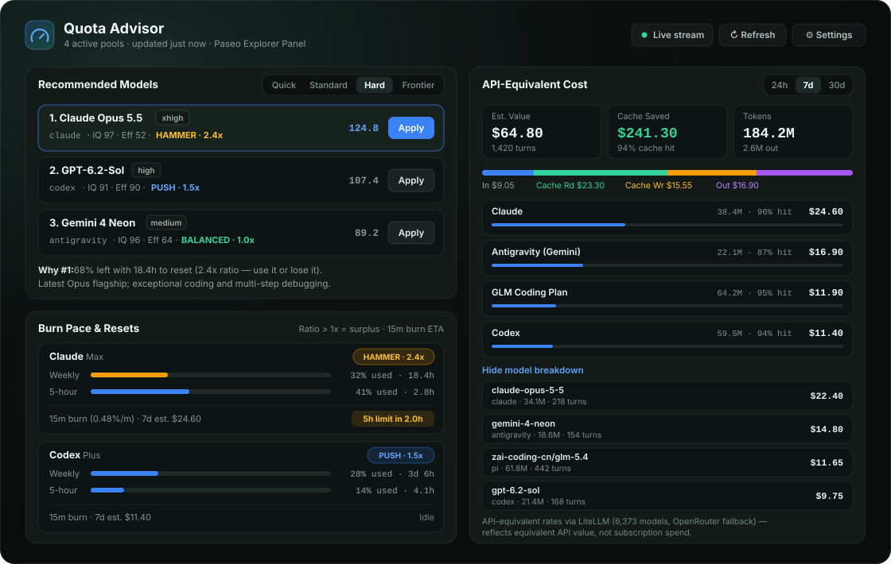
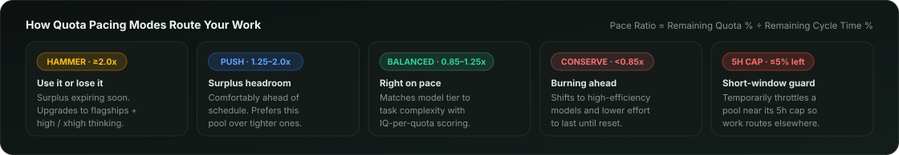

<div align="center">

# QuotaMax

**Maximize your AI coding subscriptions before they reset.**

Live quota pacing, intelligent model + thinking recommendations with 1-click Apply, and API-equivalent cost estimates across **Claude**, **Codex**, **Antigravity**, **GLM**, and **Alibaba** — built for [Paseo](https://paseo.sh).

[](LICENSE)
[](https://paseo.sh)
[](https://nodejs.org)

</div>

<br/>



---

## Why QuotaMax?

Flat-rate AI coding plans reset on rolling 5-hour, weekly, or monthly cycles. Unused quota disappears at reset — while burning too fast on the wrong pool hits a 5-hour wall mid-sprint.

**QuotaMax** treats expiring quota as a decaying asset:
- **Surplus expiring soon (`HAMMER`)?** Automatically upgrades recommendations to flagship models and `high` / `xhigh` thinking so nothing goes to waste.
- **Burning ahead of schedule (`CONSERVE`)?** Shifts toward high intelligence-per-quota workhorses and lower thinking effort to stretch until reset.
- **Want to see your real ROI?** Scans local session logs and calculates **API-equivalent value** and **prompt-cache savings** across `24h`, `7d`, and `30d` windows.



---

## Features

| Feature | What it does |
|---|---|
| **Model & Thinking Recommendations** | Ranks models across active pools for `Quick`, `Standard`, `Hard`, and `Frontier` tasks with **1-click Apply** to the focused composer. |
| **Burn Pace & Reset Urgency** | Tracks weekly/monthly & 5-hour windows, pace multipliers (`HAMMER` · `PUSH` · `BALANCED` · `CONSERVE` · `5H CAP`), and 15-minute burn-rate ETAs. |
| **API-Equivalent Cost Estimates** | Scans local **Claude Code**, **Codex**, **Antigravity** (SQLite), and **Pi** sessions; prices tokens via LiteLLM's public catalog (24h local cache) with automatic **OpenRouter** fallback and built-in rates. |
| **Cache Savings & Breakdowns** | Shows total estimated API value, cache-hit %, USD saved by prompt caching, category split (Input / Cache Read / Cache Write / Output), and per-pool / per-model tables. |
| **Optional Artificial Analysis Sync** | Add a free key in plugin Settings to refresh live Intelligence Index, Coding Index, and efficiency scores. |
| **Alibaba Cloud Usage Source** | Registers the `alibaba` source behind `paseo usage` (supports `bl` and `qwencloud` CLIs). |

---

## Quick Install

```bash
paseo plugin add https://github.com/desk36hq/quotamax.git
```

Then open **QuotaMax** from the Paseo Explorer panel, the sidebar gauge icon, or Command Center (`Open QuotaMax`).

> **Requirements:** Paseo `>=0.17.3`. Node `>=22.13` is recommended for Antigravity SQLite cost scanning (Claude Code, Codex, and Pi work on older Node versions too).

---

## For AI Agents

> **Machine-readable install & verification instructions for coding agents installing QuotaMax on a user's Paseo host.**

```bash
# 1. Verify prerequisites (Paseo >= 0.17.3; Node >= 22.13 for Antigravity SQLite scanning)
paseo --version && node -v

# 2. Install plugin directly from GitHub
paseo plugin add https://github.com/desk36hq/quotamax.git

# 3. Verify plugin status is "running" with empty ERROR column
paseo plugin ls quotamax
```

**Post-install notes for agents:**
- **No API keys required** to start. Quota pacing reads `paseo usage --json`; cost estimates read local session logs (`~/.claude/projects`, `~/.codex/sessions`, `~/.gemini/antigravity-cli/conversations`, `~/.pi/agent/sessions`).
- **No external runtime dependencies** (e.g. LiteLLM is *not* installed — only its public GitHub pricing JSON is fetched once per 24h, with automatic fallback to `https://openrouter.ai/api/v1/models` and built-in rates).
- **Optional Artificial Analysis sync:** User can add a free key from `https://artificialanalysis.ai/insights` in **Settings → QuotaMax** (or set `ARTIFICIAL_ANALYSIS_API_KEY` on the host).
- **Update / Reload / Diagnostics:**
  ```bash
  paseo plugin update quotamax   # pull latest commit
  paseo plugin reload quotamax   # restart plugin process
  paseo plugin logs quotamax     # inspect stdout/stderr if status != running
  ```
- **Uninstall:** `paseo plugin remove quotamax`

---

## Development

```bash
git clone https://github.com/desk36hq/quotamax.git
cd quotamax
npm install
npm run typecheck
npm test
```

## License

[MIT](LICENSE) — Cost estimation engine and transcript scanners adapted from [T3 Code](https://github.com/pingdotgg/t3code) (MIT).

---

<div align="center">
Built by <a href="https://desk36.com"><strong>Desk36</strong></a>
</div>
